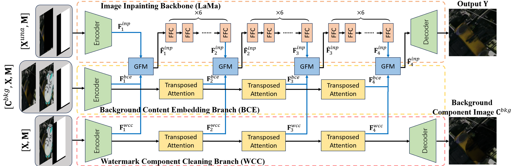

# Bridging Knowledge Gap Between Image Inpainting and Large-Area Visible Watermark Removal

**AAAI 2025**

Yicheng Leng, Chaowei Fang, Junye Chen, Yixiang Fang, Sheng Li, Guanbin Li

[[Paper (arXiv)]](https://arxiv.org/abs/2504.04687)



## Overview

We adapt a pretrained LaMa inpainting backbone to large-area visible watermark
removal. A **Watermark Component Cleaning (WCC)** branch recovers the background
component image `C_bkg`; a **Background Content Embedding (BCE)** branch extracts
prompt features from the cleaned component and the watermarked input; and four
**Gated Fusion Modules (GFM)** inject WCC/BCE features into the intermediate FFC
features of the inpainting backbone. The model is trained with coarse watermark
masks, making it robust to imperfect masks at inference time.

On ILAW (paper Table 1, fixed mask): PSNR 26.81, SSIM 0.924, RMSE 15.11,
RMSEw 18.01, LPIPS 0.094.

## Repository structure

```
big-lama/
  big-lama.yaml          # training configuration
  models/                # put best.ckpt here (not tracked)
bin/
  train.py               # training entry point
  test.py                # fixed / coarse / blind evaluation
  predict.py             # single-image inference
src/
  data/                  # ILAW reader, dataloaders, coarse-mask utilities
  training/
    modules/             # FFC backbone + WCC/BCE/GFM generator, Restormer
    losses/              # adversarial, feature matching, ResNet50 perceptual
    trainers/            # PyTorch-Lightning module and checkpoint loading
  evaluation/            # PSNR/SSIM/LPIPS metrics and validation evaluator
  utils.py
models/                  # LaMa's ADE20K and LPIPS assets
assets/overview.png
requirements.txt
```

## Installation

```bash
pip install -r requirements.txt
```

The code targets PyTorch >=1.10,<2.3 and PyTorch-Lightning 1.x.

## Training

Download the official Big-LaMa checkpoint and place it at
`big-lama/models/best.ckpt` (or change `location.pretrained_model_path`):

```bash
# Upstream HuggingFace mirror
curl -LJO https://huggingface.co/smartywu/big-lama/resolve/main/big-lama.zip
unzip big-lama.zip

# Upstream LaMa release (Google Drive):
# https://drive.google.com/drive/folders/1B2x7eQDgecTL0oh3LSIBDGj0fTxs6Ips
```

The ResNet50 perceptual loss needs the ADE20K encoder:

```bash
export TORCH_HOME=/path/to/torch-cache
mkdir -p "$TORCH_HOME/ade20k/ade20k-resnet50dilated-ppm_deepsup"
wget -P "$TORCH_HOME/ade20k/ade20k-resnet50dilated-ppm_deepsup" \
  http://sceneparsing.csail.mit.edu/model/pytorch/ade20k-resnet50dilated-ppm_deepsup/encoder_epoch_20.pth
```

Train on ILAW:

```bash
export TORCH_HOME=/path/to/torch-cache
CUDA_VISIBLE_DEVICES=0 python bin/train.py \
    -cn big-lama \
    location.data_root_dir=/path/to/ILAW \
    location.pretrained_model_path=/path/to/big-lama/models/best.ckpt
```

The default configuration follows the paper: Adam, learning rate `1e-4`,
100 epochs, batch size 16, and the paper's loss weights. On GPUs with limited memory,
reduce the batch size, e.g. `data.batch_size=2 data.val_batch_size=1`. If you do
not have the ADE20K encoder, add `losses.resnet_pl.weight=0` for a quick run.

Resolved config, TensorBoard logs, and checkpoints are written under
`outputs/<timestamp>/`. Set `location.pretrained_model_path=null` to train from
random initialization.

## Evaluation

```bash
python bin/test.py \
    --config big-lama/big-lama.yaml \
    --checkpoint outputs/<run>/models/last.ckpt \
    --data-root /path/to/ILAW/validation \
    --protocol fixed
```

Protocols:

| `--protocol` | description | paper |
|---|---|---|
| `fixed` | mask stored in the dataset | Table 1, upper |
| `coarse` | perturb the mask and average, e.g. 10 dilations | Table 1, lower |
| `blind` | white mask (no mask input) | Table 3 |

Examples:

```bash
# Coarser-mask protocol
python bin/test.py ... --protocol coarse --num-coarse 10 --iou-target 0.85

# Save [input | GT | prediction | mask] panels and skip LPIPS
python bin/test.py ... --protocol fixed --save-dir results/fixed --no-lpips

# Quick check on a few images
python bin/test.py ... --max-images 4
```

Reported metrics are PSNR, SSIM, RMSE, RMSEw (RMSE inside the mask), and LPIPS.
RMSE/RMSEw are on the 0-255 scale. LPIPS downloads the torchvision VGG16
backbone on first use; use `--no-lpips` if you only need PSNR/SSIM/RMSE.

Single-image inference:

```bash
python bin/predict.py \
    --config big-lama/big-lama.yaml \
    --checkpoint outputs/<run>/models/last.ckpt \
    --image input.png --mask mask.png --out restored.png
```

If `--mask` is omitted, a white mask is used (blind setting).

## Dataset construction

> **The ILAW dataset is being prepared for public release.** The layout below is
> exactly what the released dataset will follow, so you can already build a
> compatible split from your own background images and watermarks.

### Directory layout

```
ILAW/
├── train/
│   ├── Watermark_free_image/   # G^wf
│   │   ├── 000000.png
│   │   └── ...
│   ├── Watermarked_image/      # X
│   │   ├── 000000.png
│   │   └── ...
│   ├── Mask/                   # M (0/255)
│   │   ├── 000000.png
│   │   └── ...
│   ├── Cleancomp/              # G^bkg
│   │   ├── 000000.png
│   │   └── ...
│   └── alpha/                  # A (optional)
│       ├── 000000.png
│       └── ...
└── validation/
    └── (same five folders)
```

- Every folder must contain the **same file stem** for the same sample. The
  example uses zero-padded `000000.png`; any unique stem works as long as all
  folders match.
- Folder names are **case-sensitive** and must match exactly:
  `Watermark_free_image`, `Watermarked_image`, `Mask`, `Cleancomp`, `alpha`.
- **Naming is by stem only**; extensions must be one of `.png/.jpg/.jpeg/.bmp/
  .tif/.tiff/.webp`. `.png` is recommended to avoid compression artifacts.
- Paper sizes: train 256×256, validation 512×512. The model is fully
  convolutional, so other sizes work as long as they are multiples of 8.
- `alpha/` is optional. `Cleancomp/` and `Mask/` are required.

### Semantics

| Folder | Content |
|---|---|
| `Watermark_free_image/` | clean background `I` |
| `Watermarked_image/` | `X = (1 - A) * I + A * W` |
| `Cleancomp/` | `Gbkg = (1 - A) * I` (background component; **not** blacked out) |
| `Mask/` | `M = 255 * (A > 0)`, optionally dilated/eroded to make it coarse |
| `alpha/` | watermark alpha `A`, saved as 0-255 grayscale |

### Minimal example

The following snippet builds one ILAW sample from a background image and an RGBA
watermark:

```python
from pathlib import Path

import numpy as np
from PIL import Image

root = Path("ILAW/train")
for sub in ("Watermark_free_image", "Watermarked_image",
            "Mask", "Cleancomp", "alpha"):
    (root / sub).mkdir(parents=True, exist_ok=True)

I = np.asarray(Image.open("background.png").convert("RGB"), dtype=np.float32) / 255.0
wm = Image.open("watermark.png").convert("RGBA").resize((I.shape[1], I.shape[0]))
W = np.asarray(wm.convert("RGB"), dtype=np.float32) / 255.0
A = np.asarray(wm.getchannel("A"), dtype=np.float32) / 255.0

X = (1 - A[..., None]) * I + A[..., None] * W
Gbkg = (1 - A[..., None]) * I
M = (A > 0).astype(np.uint8) * 255

stem = "000000.png"
Image.fromarray((I * 255).round().astype(np.uint8)).save(root / "Watermark_free_image" / stem)
Image.fromarray((X * 255).round().astype(np.uint8)).save(root / "Watermarked_image" / stem)
Image.fromarray((Gbkg * 255).round().astype(np.uint8)).save(root / "Cleancomp" / stem)
Image.fromarray(M).save(root / "Mask" / stem)
Image.fromarray((A * 255).round().astype(np.uint8)).save(root / "alpha" / stem)
```

For the real dataset, watermarks are randomly scaled, rotated, and placed (not
necessarily covering the whole image), and `M` is randomly dilated/eroded to
obtain a coarse mask. To build a split, repeat this for each background/watermark
pair and use the same stem in all five folders.

## Citation

```bibtex
@inproceedings{leng2025bridging,
  title={Bridging Knowledge Gap Between Image Inpainting and Large-Area Visible Watermark Removal},
  author={Leng, Yicheng and Fang, Chaowei and Chen, Junye and Fang, Yixiang and Li, Sheng and Li, Guanbin},
  booktitle={Proceedings of the AAAI Conference on Artificial Intelligence},
  year={2025}
}
```

## Acknowledgements

This code builds on [LaMa](https://github.com/advimman/lama),
[FFC](https://github.com/pkumivision/FFC),
[Restormer](https://github.com/swz30/Restormer),
[LPIPS](https://github.com/richzhang/PerceptualSimilarity), and the ADE20K
segmentation code. See `NOTICE` and `third_party_licenses/` for details.
The project is released under the MIT license (see `LICENSE`).
